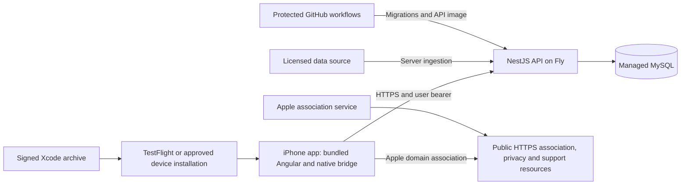

# BitStockerz — iOS application delivery plan

Decision date: October 29, 2026. Baseline: merged `main` at `59c4963` (PR #19).
Status: **release configuration implemented; mobile admission verified locally; hosted and device acceptance remain**.
Use [PRODUCT_TASKLIST.md](PRODUCT_TASKLIST.md) as the unfinished-work checklist.

## 1. Outcome and boundaries

BitStockerz will launch as an iPhone application for private personal research.
Users research markets, define strategies, backtest rules, and practice with simulated funds.
The product will not offer a publicly hosted trading workspace in the initial release.
Small public HTTPS resources support passkeys, privacy information, and customer support.

The existing Angular interface stays bundled inside Capacitor. Keep its browser harness for development and automated tests.
Retain the NestJS API, MySQL persistence, market-data ingestion, deterministic calculations, and server scheduling.
Use Fly and Aiven as the existing candidate providers, subject to renewed cost and service verification.
The maximum hosting budget remains $10/month, with free services preferred. This is not a provider-enforced spending cap.

Initial exclusions: Android, a SwiftUI rewrite, offline trading, background execution on the phone, live-money execution, subscriptions, and live AI.
Native social login, persistent device sessions, and push notifications are optional follow-up work.
These exclusions are planning defaults. Adding them requires an explicit scope decision.

## 2. Verified baseline and gaps

| Surface | Implemented baseline | Remaining gap |
| --- | --- | --- |
| App packaging | `apps/web/capacitor.config.ts` bundles local Angular assets; iOS project exists | Stage A configuration/inspection implemented; production signing and distribution remain |
| Native authentication | `PasskeysPlugin.swift` uses AuthenticationServices and checks the compiled relying party | Stable domain, signed associated-domain entitlement, real native registration/login evidence |
| Native exports | Bridge creates temporary CSV/JSON files and opens the share sheet | Files, cancellation, interruption, and cleanup acceptance on a physical device |
| Sessions | Native bearer tokens stay in memory | Confirm cold-launch sign-in is acceptable for the first beta; persistent sessions are deferred |
| Production perimeter | Legacy proxy protection remains; optional persistent mobile admission is implemented behind a disabled flag | Hosted staging acceptance before activation or proxy retirement |
| Demo | Separate `.demo` identity, fictional login, temporary tunnel, synthetic in-memory data | Cannot establish production authentication, durability, or real-data correctness |
| Deployment | `deploy.yml` and `check-deploy-config.mjs` require Vercel settings before API deployment | Decouple API deployment from website deployment and protection checks |
| Data and operations | MySQL migrations, imports, backup tooling, health checks, runner controls exist | Live provider rights, host activation, restoration, alerts, and production acceptance |

PR #17 delivered the original native prototype. PR #18 delivered branding and product copy.
PR #19 delivered the Personal Team demo and login fallback fix.

Recorded PR #19 evidence includes signed installation and a synthetic chart/backtest journey on iPhone 15 Pro.
That journey produced no closed trades. A populated trade table, native passkeys, exports, and accessibility still need device acceptance.
The final PR head `51e3c6a` passed six checks before squash merge into `59c4963`.
These are historical results, not fresh production or device verification.

## Stage A implementation evidence — November 3, 2026

Release configuration generation, channel identities, source/configuration fingerprints, version settings, artifact inspection, and the Xcode Release guard are implemented.
The supported release sync checks generated environments before compilation and both web/native output after synchronization.
The staging Release simulator build, built-artifact inspection, installation, and launch passed using fixture endpoints.
No fixture host was contacted. Native signing, physical installation, real API access, and passkeys remain separate acceptance work.
See [the build guide](IOS_PROTOTYPE.md#staging-and-production-build-configuration--november-3-2026) for commands and limits.

## 3. Architecture and trust boundaries

The app contains public configuration only: API origin, relying-party domain, app identifier, and build version.
Database credentials, provider keys, signing secrets, deployment tokens, and the production proxy key stay outside the bundle.
An installed app and its headers are untrusted clients. CORS and distribution through TestFlight do not authorize API access.
Server authorization must enforce account admission, user ownership, session validity, and operation limits.

Public resources may share the API host if routing and availability permit.
A full marketing website and Vercel deployment are not required by this architecture.
Do not retire existing protection or credentials until the replacement access path passes its gates.

## 4. Decisions and alternatives

| Decision | Selected approach and reason | Rejected or deferred alternative |
| --- | --- | --- |
| Application runtime | Keep Angular/Capacitor and the existing Swift bridge | Full native rewrite adds migration work without a demonstrated blocking requirement |
| Platform | iPhone first; preserve the current iOS 16 target pending dependency and submission checks | Android and iPad-specific layouts need separate acceptance scope |
| First distribution | Signed device beta, then TestFlight when repeatable and approved | Public App Store submission is a later gate |
| Login | Real native passkeys for the persistent beta | Fictional demo login remains synthetic-only |
| Private admission | Persistent per-user admission, enforced server-side | Shared secrets compiled into an app cannot provide a private perimeter |
| Session storage | Keep current memory-only bearer behavior for initial beta | Keychain-backed persistent sessions require expiry, rotation, revocation, and backup design |
| State | API and database own accounts, ledger, strategies, results, and scheduled work | Phone background execution cannot be required for durable work |
| Offline behavior | Show connectivity errors and retain safe form input; require network for mutations | Offline mutation queues create conflict and duplication risks outside initial scope |
| Hosting | Reuse existing Fly/MySQL design if cost and live checks pass | No provider migration is justified solely by removing the website |
| Public domain | Choose a stable relying-party host before enrolling valuable accounts | Rotating tunnel hosts are unsuitable; later domain changes can strand existing passkeys |

## 5. Implementation stages

### Stage A — Establish the app release contract

Prerequisite: this product decision. Owner: repository implementer; owner approves domain and distribution choices.

1. Preserve `com.bitstockerz.research.demo` for synthetic testing and `com.bitstockerz.research` for the persistent application.
2. Define explicit simulator, demo, staging, and production configurations without inventing environment mode support already implemented.
3. Add generation and validation for production API origin, relying party, team, bundle identity, and version/build numbers.
4. Reject release builds containing demo credentials, test-login controls, localhost, temporary tunnel origins, or placeholder relying parties.
5. Keep bundled assets; reject arbitrary remote navigation into the native bridge.
6. Record the source revision and generated configuration fingerprint without secret values.

Done when: a clean checkout produces a deterministic app configuration and rejects every unsafe release fixture.
Validation: generator tests, artifact inspection, and simulator launch. Signing is a separate external gate.

### Stage B — Replace the website access perimeter

Prerequisite: Stage A contracts. Owner: API implementer.

Repository implementation — November 4, 2026: `PRIVATE_BETA_MOBILE_ENABLED` defaults to `false`.
The optional mobile path retains the legacy proxy and requires persistent MySQL, private-beta protection, and strict passkey verification.
Registration accepts `invitation_token` only when creating options. The server binds its hash to the persisted challenge.
Successful verification creates the user, credential, session, admission, and invitation redemption in one transaction.

Direct mobile requests use an explicit route allowlist and check database session/admission state on every protected request.
The native registration form retains an invitation after cancellation and clears it after successful enrollment.

Local verification passed 1,022 API unit tests with coverage, 68 API HTTP tests, 125 web tests, and disposable MySQL admission regressions.
The unsigned staging simulator build passed artifact inspection with an iPhone-only device family.
See [mobile beta operations](docs/ops/mobile-beta.md) for the activation contract and remaining acceptance gates.
Repository implementation does not authorize activation or remove the hosted staging, origin, and device checks below.

The dedicated mobile policy must pass hosted staging before the existing proxy requirement can be retired.
Keep the old perimeter active until that acceptance passes. The implemented contract is described in the operations guide.

For the initial beta, provision invitations through an operator tool. Store only token hashes, expiry, intended identity, and consumption state.
For the single-owner beta, use that tool to provision one approved enrollment. No invitation email service or administration UI is required.
An invitation authorizes account enrollment; it does not authenticate an existing account.

Bind enrollment to the passkey challenge and consume the invitation atomically after successful registration verification.
Failed or cancelled registration must not consume the invitation. Concurrent verification must not admit multiple accounts.
Do not grant access based on an email string alone.

The implemented enrollment path creates new users only. Existing accounts are not automatically admitted.
An approved existing-account admission or reactivation procedure remains unimplemented.
Do not delete valuable accounts to bypass that limitation.

Persist admission against the authenticated user ID. Check admission and session validity on every protected mobile request.
Define revocation so an existing bearer cannot bypass suspended admission. Preserve tenant ownership checks on all object operations.
Allow only the required rate-limited authentication bootstrap routes before a session exists.
Keep operator ingestion, jobs, and database functions inaccessible to mobile users.

Restrict browser CORS to actual development and native origins where required by the transport.
Verify native client-data origins against the selected RP and real AuthenticationServices output; do not weaken WebAuthn verification.
Set trusted proxy CIDRs from observed ingress evidence. Rate-limit public bootstrap requests without trusting spoofed forwarding headers.

Done when: an invited user registers and returns after an API restart; an uninvited or revoked user cannot access protected data.
Validation: missing/expired/replayed invitation, parallel verification, cancelled ceremony, expired bearer, cross-user IDs, wrong RP, and direct API requests.
Inspect the built app and logs for secrets. Repeat admission and revocation tests against MySQL after restart.

### Stage C — Activate persistent API, passkeys, and real data

Prerequisites: Stage B gates, approved operating cost, stable host, paid signing team, and market-data rights.

1. Reinspect Fly/Aiven configuration and token expiry; prior setup records are dated evidence only.
2. Verify Linux migrations, database TLS, least-privilege application credentials, and all existing persistence gates.
3. Serve the public Apple association file with the exact Team ID and bundle ID.
   Check HTTPS, content type, and absence of redirects.
4. Configure RP, API origin, native transport, and production safeguards. Keep development email and legacy WebAuthn bypasses disabled.
5. Import licensed data and record vendor, feed entitlement, permitted use, symbol coverage, time ranges, and provenance.
6. Verify unavailable or stale data produces explicit errors or degraded status. Production must never substitute synthetic prices.
7. Retain one API instance while caches, scheduling, rate limits, and runner coordination remain process-local.
8. Keep scheduling and live AI disabled until their independent acceptance tasks pass.

Use disposable staging accounts until Stage F backup, retention, and recovery gates pass.
Done when: the phone creates a real passkey and returns to the same persisted account after both app and API restarts.
Verify charts, a backtest with closed trades, no-trade results, paper orders, P&L, and history against recorded real-data fixtures.
Record source revision, image digest, app build, device/OS, data provenance, and results separately.

### Stage D — Harden phone behavior and interrupted work

Prerequisites: Stages A–B; Stage C is required for persistent acceptance.

Audit the full journey: enrollment → research → strategy → backtest → results → paper trading → account controls.
Provide clear loading, empty, error, cancellation, session-expiry, and retry states.
Preserve unsaved form input through safe navigation and recoverable connectivity errors without saving sensitive data unnecessarily.
Cold launches require sign-in under the initial memory-only session policy.

Do not blindly retry writes after a timeout. Paper-order retries must reuse the existing idempotency contract.
Trace strategy creation and backtest submission for ambiguous outcomes. Add a durable request identity or explicit history reconciliation where needed.
Do not claim cancelling an HTTP request cancels server work. Define whether a backtest continues and how users recover its result.

If the current synchronous execution path cannot recover reliably, scope a durable submission/status contract before enabling automatic retries.
Keep runners on the server. Terminating the app must not stop a runner or duplicate an order when the app returns.

Test chart pan/zoom, keyboard avoidance, safe areas, light/dark mode, larger text, VoiceOver, touch targets, and supported orientation.
Test export success and cancellation using Files. Confirm temporary export cleanup after normal completion and later app restart.
Test deletion, session revocation, account reset, and retained archives from the app; these are existing product controls, not new claims.

Done when: the physical-device matrix passes, including airplane mode, Wi-Fi/cellular transitions, backgrounding, force-quit, and expired sessions.
Keep the existing API performance targets in [non-functional requirements](docs/product/requirements/Non_Functional_Requirements.md).
Measure startup, chart interaction, memory, and representative backtest latency before setting additional device-specific thresholds.
Record measured thresholds and device fixtures in the implementation PR; do not invent performance evidence.

### Stage E — Split API deployment from app distribution

Prerequisites: Stage B security gates and Stage A configuration gates. Distribution also requires Stage D acceptance.

Update `.github/workflows/deploy.yml`, `scripts/ops/check-deploy-config.mjs`, and their tests as one coherent change.
Remove Vercel requirements from API deployment validation only after the new access contract is verified.
Retain protected approvals, migrations, readiness checks, secret scans, dependency audits, and the production-image build.
Separate backend deploy approval from signed app upload/release approval.

Add a macOS Xcode build gate for native changes. Keep inexpensive browser tests for bundled UI regressions.
Start signed archives locally if hosted macOS usage threatens the budget. Automate distribution after that path is repeatable.

Use separate iOS marketing versions and monotonically increasing build numbers. Record them alongside the repository version and API contract version.
Support the current and previous released app builds through additive API changes and database migrations.
Define an explicit minimum supported app version only when compatibility genuinely ends. Provide a readable update-required response.

Roll back the API only to an image compatible with the current schema and distributed app versions.
Pause rollout and disable affected server features during an app incident; installed apps cannot be recalled like a website deployment.
Keep safe server defaults and a reviewed forward-fix build path.

Done when: a signed Release archive installs, survives upgrade without losing server data, and reaches a compatible staging API.
Before retiring Vercel, verify no runtime, OAuth, support, policy, monitoring, or domain-association dependency remains.
Then remove obsolete deployment credentials and revoke unused provider tokens through an approved credential cleanup.

### Stage F — Operate the private beta

Prepare backup, retention, and recovery work alongside Stage C, before valuable data enters service.
Distribution requires Stages C–E. Owner approval is required before valuable data or paid resources enter service.

Configure independent encrypted backups, key custody, retention, deletion records, and a restoration drill.
Prove recovered users, auth methods, strategies, backtests, orders, balances, and admission state are correct.
Invalidate restored sessions and outstanding invitations/challenges as part of recovery.
Replay deletion records and post-backup admission revocations before reopening access.
The external admission-revocation record and reconciliation procedure require implementation and operator acceptance.

Test alert delivery for API/database failure and stale ingestion. Establish support recipients and sanitized incident reproduction.
Track actual hosting and optional provider usage against the owner's budget. Record a response when forecast spend exceeds the cap.

For TestFlight, create an App Store Connect record, archive/upload an approved build, and provide beta information and feedback contact.
External testing can require Apple review. Plan build renewal because TestFlight builds expire after 90 days.
Apple distribution and authentication prompts require the owner where credentials or agreements are involved.

Done when: the approved device or tester receives the app, completes the persistent journey, and can report a failure with a safe request reference.

### Stage G — Public App Store release, when requested

This stage is separate from the private personal beta.
Prepare screenshots, age rating, privacy disclosures, support URL, privacy-policy URL, export-compliance answers, and review access.
Audit SDK privacy manifests and required-reason API declarations against the actual dependency inventory.
Verify in-app account deletion and the published retention policy against server and backup behavior.
Provide reviewers an approved account or complete demo mode without weakening the production admission policy.
Keep required backend services available throughout review.

If adding social login, validate Apple's current equivalent-login requirements and implement native provider linking and recovery before enabling it.
If monetization is requested, plan payment and store requirements separately before implementing purchases.

Done when: public-release metadata matches the app, device acceptance is recorded, and the owner approves submission and release.

## 6. Change packages and integration points

Keep each package separately reviewable through logical commits and its own evidence.
Stages A and B share the combined preparation PR. Credential retirement remains separate from the first admission implementation.

| Package | Source and contract owners | Migration or verification boundary |
| --- | --- | --- |
| A: release configuration | `scripts/ios/prepare.mjs`, configuration tests, Angular environments, Xcode settings, Capacitor config | Implemented generation and artifact gates; signing and hosted/device acceptance remain |
| B1: enrollment and admission | `apps/api/prisma/schema.prisma`, migrations, auth registration/challenges, configuration service | Implemented invitation binding and atomic new-user enrollment; existing-account admission/reactivation requires an approved procedure |
| B2: mobile perimeter | `PrivateBetaGuard`, auth/session guards, auth rate limits, app HTTP interceptors, native passkey bridge | Preserve legacy protection until staging verifies the new policy; reject cross-user and revoked-session requests |
| C: real service acceptance | API configuration, migration tooling, market-data importer/providers, public association routing | Reinspect providers and rights; verify data and native cryptography separately |
| D: app recovery and usability | Research/market/strategy/backtest/trading/account pages, API mutation contracts, native share bridge | Trace actual execution ownership before adding retries or new job infrastructure |
| E1: backend delivery | `deploy.yml`, `check-deploy-config.mjs` and tests, health workflow, operational runbook | Remove Vercel requirements together; preserve migration and access gates |
| E2: app delivery | Xcode project, release scripts, CI native job, version metadata | Signing inputs stay outside Git; signed distribution requires owner approval |
| F–G: operations/distribution | Backup tools, deletion records, health alerts, store metadata and policy resources | External restore, recipient delivery, tester installation, and review evidence cannot be replaced by unit tests |

Before reusing existing accounts, define approved admission and reactivation without granting every existing account access.
The current operator tool provisions new-user invitations. It does not admit or reactivate existing users.
Fail closed for unknown users and ambiguous migration state.

Use additive migrations first. Preserve compatibility while old app builds and the old perimeter can still make requests.
Rollback must not silently re-enable revoked admission or resurrect consumed invitations.

## 7. Risk review and resolutions

| Trigger and consequence | Resolution | Closing gate |
| --- | --- | --- |
| Disabling the proxy guard exposes signup and data routes | Enforce invitations, persistent admission, authentication, and existing tenancy before switching topology | B |
| Compiled shared key is extracted from the app | Production bundle rejects demo/shared credentials | A, B |
| Enrollment succeeds after revoked or replayed invitation | Bind challenge and consume invitation atomically at verification | B |
| API restart forgets admission or sessions | Persist and test restart hydration; revoke recovered sessions during disaster restoration | B, F |
| RP hostname changes after enrollment | Select stable RP before valuable accounts; document credential migration before any later change | C |
| Lost response prompts a duplicate order or backtest | Reuse order idempotency; reconcile other writes or add durable identities before retrying | D |
| Phone is backgrounded while runner executes | Server owns scheduled state; restart and duplicate-job tests remain required | D |
| API rollback breaks an installed app | Test current/previous app compatibility and additive schema changes | E |
| App Store requirements become beta blockers | Keep device beta, TestFlight, and public release as separate gates | F, G |
| Removing Vercel removes the association or support host | Verify endpoint ownership and dependencies before retirement | E |

## 8. Owner dependencies and implementation authority

Repository work can proceed through contracts, admission implementation, release configuration, tests, CI changes, and draft release tooling.
The owner must supply or approve the stable domain, available paid developer team, resource costs, market-data rights, support contact, and retention decisions.
Signing, account agreements, device trust, TestFlight upload, and public release can require direct owner authentication or approval.
Previously provisioned services must be reinspected before use. This plan does not authorize new billable resources or store submission.

Recommended delivery order: **A → B → C → D → E → F distribution**.
Prepare Stage F operations alongside C; its backup/recovery gates precede valuable-data acceptance.
Repository preparation for C–E can overlap after contracts settle.

Stages A and B are implemented locally. Next, complete hosted admission and Stage C prerequisites while preparing Stage F operations.
Keep production deployment disabled until the required release gates pass.
Stage G and optional extensions do not block the private device beta.

## 9. Sources and maintenance

Architecture baseline: `59c4963`, October 29, 2026. Runtime inspection and local/CI evidence: `b1ce7c7`, November 4, 2026.
Use the status notes and root checklist to distinguish implemented code from remaining acceptance.
Official references checked October 29, 2026:

- [Capacitor iOS runtime](https://capacitorjs.com/docs/ios): existing web UI can be packaged with native capabilities.
- [Apple passkeys](https://developer.apple.com/documentation/authenticationservices/supporting-passkeys): relying-party association is required.
- [Associated domains](https://developer.apple.com/documentation/xcode/supporting-associated-domains): HTTPS association-file and entitlement configuration.
- [TestFlight](https://developer.apple.com/help/app-store-connect/test-a-beta-version/testflight-overview/): beta distribution, review, and build lifetime.
- [App privacy](https://developer.apple.com/help/app-store-connect/manage-app-information/manage-app-privacy/): privacy URL and data disclosures.
- [Account deletion](https://developer.apple.com/support/offering-account-deletion-in-your-app/): deletion initiation within account-creating apps.
- [App Review Guidelines](https://developer.apple.com/app-store/review/guidelines/): review access, login, and public-release requirements.

Recheck Apple submission requirements and installed dependency requirements when preparing a distribution build.
